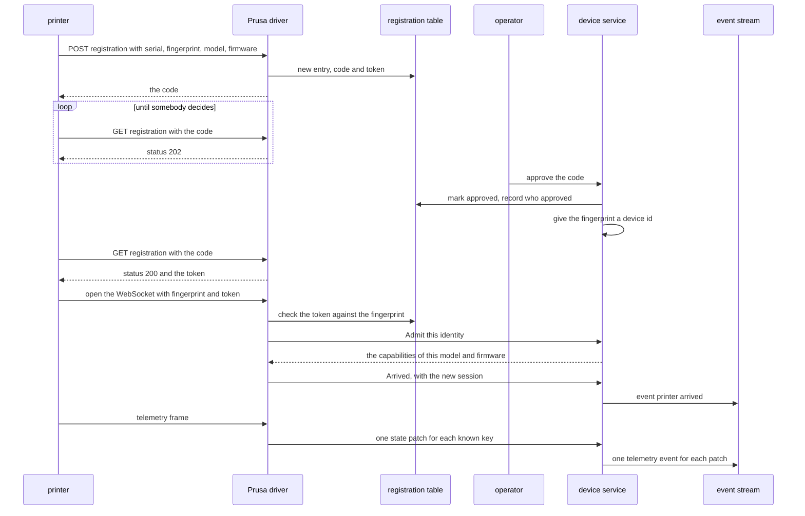
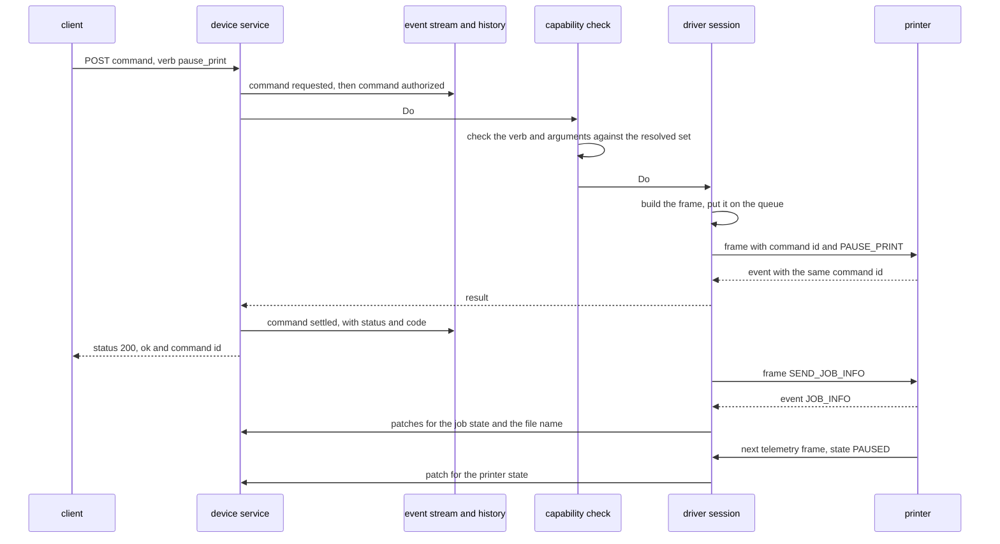

A driver is the code that talks to one family of machines in the language those
machines use. The Prusa driver is `internal/connector/xbuddy`. A Prusa printer
opens the connection itself. It asks for a registration code over HTTP, shows
the code on its screen, and asks again until somebody approves the code. Then
it gets a token, which is a secret it sends on every later connection. With the
token it opens a WebSocket, a connection that stays open in both directions.
Over that connection the printer reports readings and the server sends
commands. The server core does not know this protocol. It sees a session, which
is one connected machine behind the interface in `sdk/connectorapi`. A session
gives the core an identity, a set of capabilities, a `Do` method for commands
and a channel of state patches. A state patch is one new value for one path,
such as the nozzle temperature of the printer. A capability is one verb or
feature the machine supports, with the arguments and limits of that verb. A
driver for another machine implements the same interface as a separate Go
module, and a build configuration adds it to the binary.

## A printer joins for the first time

The example is a Prusa printer on a server where the connector has
`mode: token`, so a person approves every printer.

1. `mountOne` in `internal/app/connectors.go` builds each connector under
   `core.connectors` at start. A configuration with no connector gets the
   dialect `builtin.DefaultConnector` names, which is the Prusa driver in this
   build. A driver that implements `Inbound` returns an HTTP handler, and the
   Prusa driver asks for the fixed paths of its firmware through `Routes`.
2. `Driver.handleBeginRegistration` in `internal/connector/xbuddy/xbuddy.go`
   reads the body and calls `registrar.begin` in
   `internal/connector/xbuddy/registration.go`. `issue` creates a code and a
   token with a random generator and stores the entry under the full
   fingerprint. A printer that registers again gets the code it already has.
3. `handlePollRegistration` calls `complete`. An entry that nobody approved
   answers 202, and its code stops working after 24 hours.
4. The operator calls `POST /api/v1/registrations/{code}/approve`.
   `registrations.admit` in `internal/app/registrations.go` asks each driver
   that implements `Admits` until one knows the code. `registrar.Approve`
   marks the entry and writes it to the registration store. Then
   `devices.registrationApproved` in `internal/app/deviceregistration.go`
   gives the fingerprint a device id. The person who approved becomes the owner
   when the printer arrives.
5. The next poll answers 200 with the token. The store on disk has only the
   SHA-256 hash of a token.
6. `handleWebsocket` calls `registrar.authenticate`. The firmware sends the
   full fingerprint in the registration body and only its first 16 characters
   in a header. `resolveLocked` accepts the short form at exactly that length,
   and the token check uses the full entry.
7. `arrivals.Admit` in `internal/app/devices.go` runs on every connection.
   `Resolver.Arrive` in `internal/printer/capability/resolver.go` intersects
   the driver's `Baseline` with the profile for this model and firmware from
   `internal/printer/profile`. The result can only be smaller than the
   baseline, and every arrival gets a new epoch number. There is no probe here:
   the session does not exist yet, so the third tier is resolved at step 8.
8. `Driver.join` builds the session with `newSession` in
   `internal/connector/xbuddy/session.go`, upgrades the request to a WebSocket
   and calls `arrivals.Arrived`. When the session implements
   `connectorapi.ReportsProbe`, `devices.arrived` asks it which capabilities
   this printer supports. It removes every other capability from the
   resolution, and the epoch number stays the same. It registers the device in the
   authorization graph and wraps the session with `capability.Wrap`. It then
   publishes `printer arrived` and starts `devices.pump`, the goroutine that
   reads the state channel of this session.
9. `Session.attach` in `internal/connector/xbuddy/link.go` starts `read`,
   `keepalive` and `requestInfo` for the connection. `dispatchTelemetry` in
   `internal/connector/xbuddy/inbound.go` turns each known key of a telemetry
   frame into a patch. `device.record` in `internal/app/devicetext.go` stores
   the value, and `pump` publishes it as an event.

With `mode: none`, `issue` approves the entry at once and tells the device
service through the function from `UseApprovals`. The driver's own default is
`none`. The server writes the first run's choice over it: `none` when the
operator chose to let every printer in, and `token` when they chose to be asked
first. While nothing is recorded, the server writes `token`. A `mode` the
operator wrote in `core.connectors` wins over all of that. A
printer that comes back later starts at step 6. When the model and firmware are
the same, `Driver.reattach` puts the new connection under the session that
already exists. An outbound driver such as Moonraker skips steps 1 to 6.
`dials.once` in `internal/app/dial.go` calls `Connect` for each address in the
endpoint list, and then calls `Admit` and `Arrived` the same way.

## A command goes to the printer and the answer comes back

Anna clicks pause. The authorization steps before `Do` are on
[the authorization graph](authorization.md).

1. `devices.Command` in `internal/app/devices.go` creates the command id
   before the permission check. After the check it publishes
   `command requested` and `command authorized` on the origin of the device.
   `publishCommand` in `internal/app/devicecommand.go` also writes each frame
   to the history store on the same goroutine. This is the durable command
   record, and `GET /api/v1/commands/{command_id}` reads it.
2. `Session.Do` in `internal/printer/capability/session.go` validates the verb
   and every argument against the resolved set and fills in defaults. A command
   that fails this check never reaches the driver.
3. `Session.Do` in `internal/connector/xbuddy/session.go` looks the verb up in
   `wireTable` in `internal/connector/xbuddy/verbs.go`. `build` checks a path
   argument with `firmwarePath` and encodes the frame. The frame goes on a
   queue with room for 32 commands. A full queue refuses the command with
   `COMMAND_QUEUE_FULL`.
4. `Session.pump` takes one command from the queue at a time. `deliver` waits
   in `waitLink` until a connection exists, so a command for a printer that is
   switched off waits for it. When the write fails, the printer never received
   the frame, and `deliver` sends it on the next connection.
5. `awaitAnswer` waits for the event with the same id. It also stops at the
   command deadline of 60 seconds, when the connection ends or when the session
   closes. The result is then `COMMAND_UNANSWERED`, and the driver never sends
   the frame again, because the printer may have done the work. `RESET_PRINTER`
   and `M999 R` reboot the printer, which drops the socket before it can
   answer, so for these two a connection that ends counts as success. A G-code
   command answered `ACCEPTED` is still running on the printer, which refuses
   every other command until it reports `FINISHED` or `FAILED`.
   `awaitRunning` holds the queue until then, for at most the same deadline.
6. `dispatchEvent` reads the command id first and calls `answer`. `resultOf`
   turns a `REJECTED` event into a result with `OK` false, a fault code and the
   printer's own reason. A `FAILED` event becomes an error. Every other event
   with the id means success.
7. `publishSettled` writes the settled frame on a context that does not end with
   the request. `settleStatus` chooses `succeeded`, `refused`, `failed`,
   `timed_out` or `abandoned`. It sets `outcome_unknown` when the command may
   have been on the wire: a deadline, a caller that went away, or
   `COMMAND_UNANSWERED` from the driver. A refusal by the printer is status 200
   with `ok: false`. A failure is a problem document with the command id in it.
8. The firmware sends nothing after pause, resume or stop. For these verbs
   `requestJobRefresh` in `internal/connector/xbuddy/jobrefresh.go` asks for
   `SEND_JOB_INFO`, and `noteJob` writes the answer as patches. The new printer
   state arrives with the next telemetry frame.

## A file goes to the printer in blocks that the printer asks for

`Session.Send` in `internal/connector/xbuddy/transfer.go` sends the verb
`START_INLINE_DOWNLOAD` with a random token and the size of the file. The
printer then asks for byte ranges in frames that `classify` reads as block
requests. `serveBlockRequest` runs on the read goroutine and only puts the
request on a channel. `serveBlocks`, one goroutine for each transfer, writes
the bytes as binary frames. A session has one transfer at a time. After the
event `TRANSFER_FINISHED`, `confirmLanding` in
`internal/connector/xbuddy/landing.go` lists the folder on the printer and
checks that the file is there with the right size. The frame formats are in
[the xBuddy WebSocket protocol](../prusa-xbuddy-websocket-protocol.md).

## A driver from outside the repository

`examples/adapters/moonraker` is a driver for Klipper machines. It implements
`Outbound`, so the server dials the machine. It is a Go module that requires
only `sdk/`. The file `build.yaml` in the
folder names the module, and `make compose-build` builds a binary with it.

- `connectorapi.Register` in `sdk/connectorapi/registry.go` adds the driver
  type from an `init` function. The optional `Dialect` has the brand names, a
  word for what a person supplies before the machine can join, the values
  this driver uses for "admit every machine" and "ask me first", and the
  device models it reaches. The host serves those models in the device-model
  vocabulary beside the Prusa ones. The moonraker driver declares
  the Klipper row there, with a drawing it embeds.
- `connectorapi.RegisterKind` in `sdk/connectorapi/permissions.go` declares a
  device kind and its verbs, each with the class `operate` or `configure`.
- The interfaces in `sdk/connectorapi/host.go` are optional, such as `Admits`,
  `TakesLogger`, `CountsLink` and `ReportsProbe`. The host tests for each one
  with a type assertion. A session that implements `ReportsProbe` says what its
  own machine has, and the host lists and commands against that instead of the
  driver's whole baseline.
- `RunDriverContract` in `sdk/connectorapi/connectorapitest/contract.go` is the
  conformance suite, and the author calls it from a test in the driver's module.
  It checks that a command is answered while nothing reads the state channel,
  and that a session implementing `CountsLink` reports totals that only grow.
  It cannot make a machine report faster than the channel drains, so the bound
  and the drop rule are held by the driver's own tests.

## Rules a change must keep

1. One goroutine reads one connection, and `read` handles a frame completely
   before it reads the next one. With a second reader, the answer to a command
   can pass the telemetry that the printer sent before it.
2. A telemetry value and a dialog field go into the patch as the bytes the
   printer sent. `dispatchTelemetry` and `dialogPayload` keep the
   `json.RawMessage`. Decoding a number into a Go float and encoding it again
   changes large integers and the number of decimals.
3. `Session.report` never blocks. The inbox holds 64 patches for a printer
   with one head and more for one with several (see `patchBacklogFor`). When
   it is full, `report` removes the oldest patch, counts it in `dropped` and
   adds the new one. A blocking `report` stops the read goroutine, and then no
   command gets its answer while the host is slow. The doc comment on
   `Session.State` in `sdk/connectorapi` asks the same of every driver. Never
   wait for the host, bound what waits, drop the oldest and count it.
   `connectorapi.CountsLink` is how the host reads that count.
4. A dialog patch does not go through the inbox. Each path in `dialogPaths` has
   its own slot in `reserved`, a newer value replaces the one that waits, and
   `patchPump` sends the slots first. The printer sends the text of a dialog
   only once, so a dropped dialog patch leaves a person with a question they
   cannot see.
5. One command is on the connection at a time, and a command that was written
   is never written again. `pump` is the only goroutine that calls `deliver`.
   A retry after the write can start a print twice.
6. Every command that enters the queue gets exactly one result. `call.settle`
   uses a `sync.Once`, and `dropQueued` answers every waiting command when the
   session closes. A command without a result keeps its caller waiting until
   the request times out, and its record stays open.
7. The core reads what a driver declares and never tests the type name of a
   driver. The brands, the setup step, the admission words and the models it
   reaches come from `Dialect`, the routes from `Routes` and the profiles from `Profiles`. A
   branch on a name in the core is a feature that a driver from outside cannot
   have. `internal/app/builtin` names the dialects this binary carries, and
   `TestNoDialectIsNamedInTheCoreOutsideBuiltin` in `internal/arch` refuses a
   dialect name anywhere else under `internal/app`.
8. A driver from outside imports `sdk/` and no `internal/` package. Go refuses
   the import because the module is separate, and `make side-modules-check`
   builds each module in its own folder. An interface that a driver must
   implement therefore belongs in `sdk/connectorapi`.
9. A driver declares its verbs, and each verb has a class from the closed set
   in `Classes`. `ValidateKindDeclaration` refuses any other class. A class
   that a driver could define would let the driver decide who may send its
   commands.
10. The host limits every text from a driver before it stores it and before it
    publishes it. `device.record` cuts a string value at 32768 bytes, refuses a
    longer path, and accepts no new path when the state of one device is over
    `device_state_budget`. It hands `pump` the patch as it kept it, so the
    telemetry event carries the same bytes as the tree and a refused patch
    reaches no subscriber. `machinetext.ClipIdentity` cuts the vendor, model,
    serial and firmware of an identity at 256 bytes. Without these limits one
    machine can fill the memory of the server.

## What this part does not do

`closeOpenCommands` in `internal/app/commandsweep.go` closes the records that a
stopped process left open, and it closes at most 1000 of them at each start.
Nothing sends a command again after a restart, and the queue of a session is in
memory only.

The Prusa driver limits one frame to 1 MiB and a registration body to 16 KiB,
and a driver from outside has to set its own limits.

The Prusa driver reports no probe. Its handshake carries the model, the
firmware and the serial. The `INFO` event that follows lists storages and no
verbs, so nothing the printer says at connect names a capability.

A handshake with no `User-Agent-Version` header takes the firmware from the
registration, and a printer keeps its token across a firmware upgrade. When
such a printer's `INFO` names another firmware, `Session.reportFirmware`
writes it into the registration and ends the session. The printer connects
again under the new firmware, and the device record, the capabilities and the
admission log follow it. A handshake that carries the header is filed under
the header and `INFO` does not change it.

A registration needs no credential, so anything that can reach the port can
add an entry. The table has room for 400 entries by default, and
`makeRoomLocked` never removes an entry that an operator approved. With
`mode: none` the server admits every machine that connects.

## Failures and where they show up

`GET /api/v1/devices/{device_id}` shows whether the printer is connected, when
it left and why, and a `link` block with the dropped patches and the frames the
driver could not read. `GET /api/v1/registrations` lists the machines that
wait for a decision. The driver writes its log lines with the connector name,
the serial and the model.

| what happens | what the server does | where it shows |
|---|---|---|
| the registration table is full of approved entries | refuses the new registration with status 503 and `Retry-After` | log `the registration table is full` |
| the token or the fingerprint is wrong | status 401 on the WebSocket path, status 403 on the auth path | nothing in the log |
| the printer answers no ping for 60 seconds | `read` ends, `detach` keeps the session and its queue | event `presence changed`, `pcl_printer_up` |
| the printer sends a frame the driver cannot read | drops the frame, keeps the connection, counts it | `link.refused_frames`, one warning for each connection |
| the host reads patches too slowly | drops the oldest patch | `link.dropped_telemetry` |
| the queue of a session is full | refuses the command | status 409, `COMMAND_QUEUE_FULL` |
| the printer does not answer a command, or disconnects after the write | settles the command, never sends it again | `COMMAND_UNANSWERED`, record status `timed_out` or `failed`. A reset that drops the connection succeeds |
| the printer comes back with another model or firmware, or its `INFO` names another firmware | closes the session and opens a new one. Queued commands fail | `PRINTER_CHANGED` with both firmware versions |
| the session ends while commands wait | answers each waiting command | `PRINTER_SESSION_ENDED`, warning with the count |
| a value is too long, or the state budget is used up | cuts the string, or refuses the patch and publishes no event for it | `pcl_printer_state_bounded_total` |
| a transfer finishes and the file is not in the listing | `Send` returns an error | log `the transfer ended` with `arrived` false |
| the server stops while a command is open | the next start closes the record | record status `server_restarted` |
| a driver declares an invalid dialect, class or name | `Register` or `RegisterKind` panics in `init` | the binary does not start |

The Prusa numbers are constants in `internal/connector/xbuddy/inbound.go`,
`session.go` and `registration.go`. The `Config` struct in `xbuddy.go` lists
the keys an operator can set under `core.connectors.<name>.config`. The host
limits are in `internal/app/devicetext.go` and
`internal/kernel/machinetext/machinetext.go`.

## Files to read first

- `sdk/connectorapi/driver.go` and `sdk/connectorapi/direction.go`: the
  interfaces `Driver`, `Session`, `Inbound`, `Outbound` and `Arrivals`
- `internal/connector/xbuddy/xbuddy.go`: the HTTP routes of the Prusa driver,
  and how a connection becomes a new session or joins an existing one
- `internal/connector/xbuddy/session.go` and
  `internal/connector/xbuddy/link.go`: the command queue, the inbox, and how a
  connection is attached and removed
- `internal/connector/xbuddy/registration.go`: codes, tokens, the modes and the
  size limit of the table
- `internal/app/devices.go`: `admit`, `arrived`, `pump` and `Command`, the host
  side of every driver
- `internal/printer/capability/resolver.go`: how the baseline and a profile
  become the capability set of one machine

A guide for an author is [writing a driver](../writing-a-driver.md). The part
of the host around a command is on
[the application core](the-application-core.md).

## Tests for a change here

- `go test ./internal/connector/xbuddy/` runs the driver against
  `internal/printer/simulator`, a printer simulator that uses the same routes
  and frames as the firmware
- `go test ./internal/printer/...` runs the resolver, the profiles and the
  simulator. `profiles.json` is generated, and the constant `GeneratedBy` in
  `internal/printer/profile/profile.go` has the command that writes it
- `go test ./internal/app/` has the tests for arrival, commands, the command
  record and registrations
- `make test-race RACE_PACKAGES=./internal/connector/...` for any change to a
  goroutine, a channel or a lock in the session
- `make sdk-check` checks that a module outside the repository compiles against
  `sdk/`, and it runs `make side-modules-check` for the example drivers
- `make compose-check` builds a binary with an adapter from outside and checks
  that the server lists it
- `make capabilities-check` after a change to a profile or to the verbs
- `make lint` and `make test` before the push
